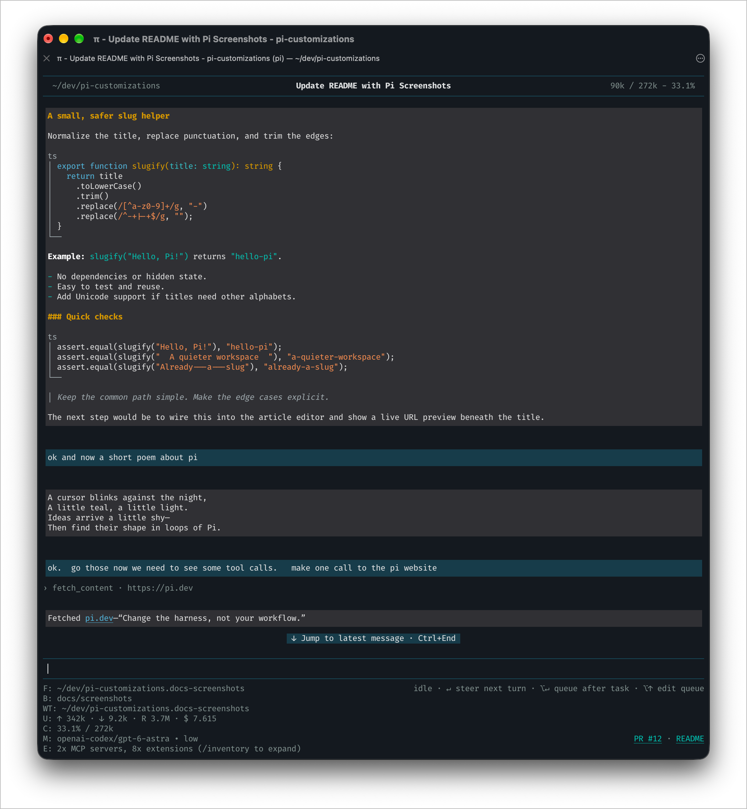

# Pi customizations

Personal extensions and themes for [Pi](https://github.com/earendil-works/pi).

Pi’s strength is that it’s designed to be uniquely yours. Like any of these ideas? Ask Pi to implement them in your own setup.

## Screenshot

[](docs/images/pi-customized.png)

*Chat-style formatting, fancy code blocks, and minimized tool calls. Click the screenshot to view it at full resolution.*

## Included extensions

- [`ui.ts`](extensions/ui.ts) — unified presentation: header, footer/editor, message panels, code blocks/copying, and tool summaries/disclosure. Internal modules live under [`lib/ui/`](lib/ui/); persistent preferences belong to `ui.json` in Pi's agent directory. `/header-bar [on|off|toggle]` saves whether the header's top rule is visible.
- [`session-rename.ts`](extensions/session-rename.ts) — independently names sessions with concise, scannable topics; retains its own `rename.json` settings.

The package manifest loads only these two entry points. The six former visual entry points are deprecated compatibility shims; their frozen implementations live under [`legacy/`](legacy/). Switching from legacy to unified presentation requires a fresh Pi process, not `/reload`. Mobile/compact presets and compatible message layout are planned follow-ups; default styling is unchanged.

See [`extensions/README.md`](extensions/README.md) for details and installation.

## Thinking text

Thinking content is shown inline using the same neutral-gray panels, normal text color, and Markdown typography as regular assistant prose. It streams in place, rather than appearing as an italic `Thinking...` disclosure. While this extension is loaded, Pi’s hide-thinking setting and click-to-collapse behavior do not hide these panels; no installed settings are rewritten. Explicit Markdown emphasis still renders normally.

This is display-only: thinking blocks, signatures, and their `assistant-thinking` Markdown-transformer identity remain intact. Stored sessions and model context are unchanged. `/plain-text` and code-copy behavior apply to thinking panels too.

## Copy-friendly assistant messages

Assistant panels have no visible controls. `/plain-text` toggles all assistant messages between styled Markdown and original Markdown, including new messages and streaming updates. Plain mode removes panel fill and side borders, replaces the top and bottom caps with simple full-width dividers, and shows literal code fences rather than decorated code blocks. Content keeps its existing wrapping width and shifts left by one column; Markdown itself can change the message height. The mode resets to formatted on session start or reload.

Pi's built-in `/copy` copies the last assistant message. `/copy-code` copies the last rendered assistant text block's code snippets, joined with a blank line. In fullscreen mode, clicking a code block’s vertical `│` copies that whole block (without fences or the language label) and shows “Copied”. Code-body clicks, drags, and scrolling retain native behavior. Divider copying is disabled in plain-text mode; regular terminal mode uses the copy commands instead. This does not change tool output or user-message rendering.

## Included theme

- [`turquoise`](themes/turquoise.json) — a dark palette that replaces Pi's violet/pink accent family with turquoise and teal

See [`themes/README.md`](themes/README.md) for installation and interaction details.

## Tests

Use Node 24+ and Python 3 on macOS or Linux:

```sh
npm ci --ignore-scripts
npm run check
```

Checks run in three layers:

- `npm run typecheck` checks every extension against the pinned Pi API, including editor vs. full UI theme types (Pi 1.2.0).
- `npm test` runs helper tests and real Pi component rendering: custom editor rendering, themes, widths, autocomplete, cursor preservation, footer, and header lifecycle. Runtime tests are mandatory, not silently skipped.
- `npm run test:tui` launches the **bundled CLI** in isolated pseudo-terminals using the package manifest. It checks startup, two reloads, header preference persistence, autocomplete, resize, clean exit, and crash logs in fullscreen/regular modes with turquoise/dark/light themes. It also smoke-tests the deprecated entry points in fullscreen/regular dark mode. It uses a temporary HOME/config/cwd, disables MCP and automatic networking, and makes no model calls. Failure output is saved in `test-artifacts/`.

GitHub Actions runs the same checks on Linux and macOS. Pi dependencies are pinned in `package-lock.json`; upgrade them deliberately and rerun the full suite. To probe another installed Pi runtime, set `PI_PACKAGE_ROOT=/absolute/path/to/@earendil-works/pi-coding-agent` for `npm test` and `npm run test:tui` (typechecking still uses local dependencies).

These checks catch API and rendering crashes, not every visual defect or live-provider interaction. Manually inspect streaming/tool-heavy conversations after renderer changes.

## Other extensions in use

MCP uses Pi's native support (`~/.pi/agent/mcp.json` or `.pi/mcp.json`). Remove `pi-mcp-adapter` if installed: registering its `/mcp` command disables native MCP for sessions.

- `herdr-agent-state.ts` — Herdr-managed agent status integration
